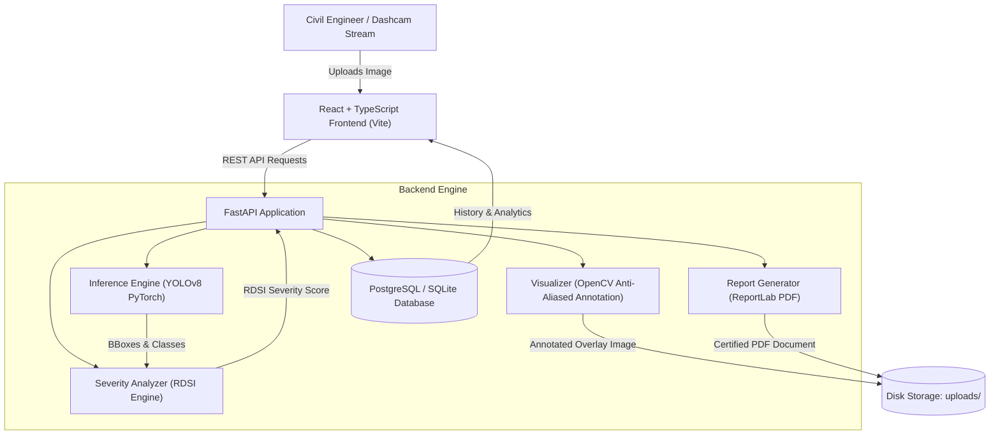
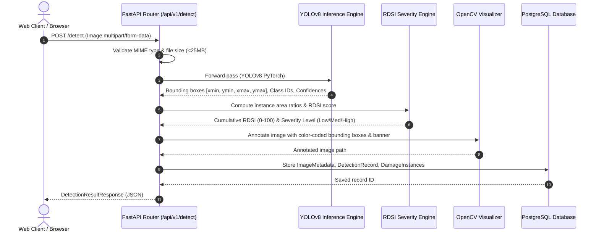
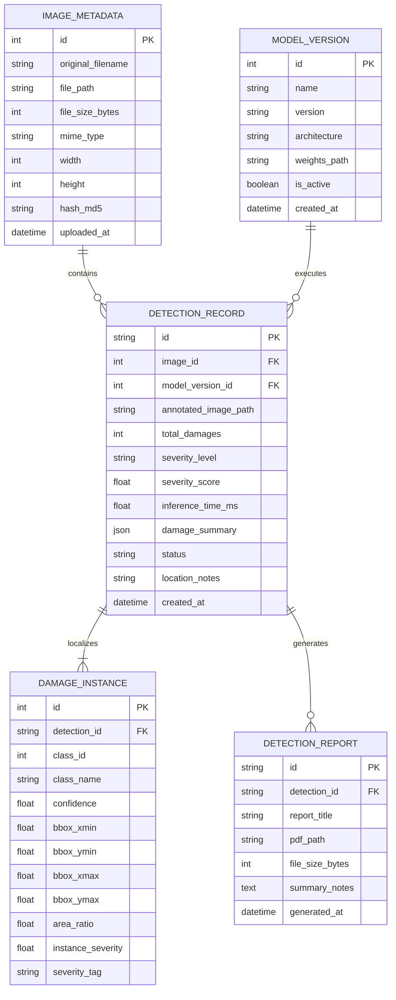

# RoadGuard System Architecture

## 1. High-Level Architecture Overview

RoadGuard is an end-to-end intelligent road infrastructure inspection and decision-support system. It integrates computer vision (anchor-free YOLOv8), deterministic civil engineering assessment (Road Damage Severity Index - RDSI), a high-performance REST API backend (FastAPI), and a modern reactive dashboard (React, TypeScript, Tailwind CSS, Recharts).

---

## 2. Deep Learning Pipeline & Inference Sequence

---

## 3. Database Entity-Relationship (ER) Schema

---

## 4. Hardware Optimization (Apple Silicon M2 / CPU)
- **Model Size**: YOLOv8n has ~3.2M parameters (~12 MB checkpoint size), making it ideal for the 8GB RAM constraints of the development MacBook Air M2.
- **Hardware Acceleration**: Automatic device detection switches between PyTorch MPS (Metal Performance Shaders on Apple Silicon), CUDA on Google Colab GPUs, and CPU fallback with zero code changes.
- **Asynchronous Execution**: Image parsing, inference, database transactions, and PDF compilation execute asynchronously without blocking FastAPI event loops.

